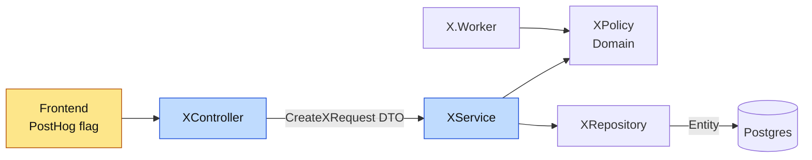

# Lift the Gaze

The user is stronger on frontend than backend. This skill does three things, in this order:

1. **Altitude** — before discussing *which* controller/service/repo to change, ask whether the question disappears if the decision is made higher up.
2. **Ball the options** — 2-3 real alternatives, one question at a time, each with its consequences. The user decides.
3. **Layer placement** — for the code that remains, show which layer each piece belongs in and what it looks like when it lands in the wrong one.

It is a conversation that teaches, not a review that blocks. Talk in the user's language (Swedish if they write Swedish). Keep each turn short: one diagram, one table, one question.

Reference material: `references/layers.md` (Repo layer map, wrong-place symptoms, why DTOs). Visual explainer: `layers.html` in this folder, published at https://claude.ai/artifact/STniiXQ7hda1GrUTifKkMU — link it when the user wants the picture.

---

## Step 0 — Read before you talk

Read the ticket/plan, then find the real code it touches. Do not reason from layer names alone.

- Which service(s)? `services/<Domain>/<X>.API` (Controllers, Services, Models/DTOs, Handlers) and `<X>.Domain` (Models = entities, Repository, Policies, shared Services, Mappers).
- Who reaches this code? Endpoint only, or also Rebus handlers and `*.Worker.*` projects? A gate on the controller does not cover a worker.
- Who actually has access to the feature today? (retailer, contract, permission, PostHog flag). Grep, don't assume.

## Step 1 — The altitude ladder

Walk this ladder top-down and stop at the **highest rung that can carry the decision**. Every rung you can stop at higher up deletes branches in every rung below.

| # | Rung | Repo mechanism | It answers |
|---|------|-------------------|------------|
| 0 | Scope | The ticket itself | "Does anyone without access need this at all?" |
| 1 | Contract / entitlement | `ServiceContract`, `SubContract` (`shared/Repo.Shared.Models/ServiceContracts`), e.g. `ICallbackEntitlementReader` | "Has the customer bought it?" |
| 2 | Retailer | `RetailerType`, `CanDoActionOnRetailer`, retailer-targeted PostHog flags | "Is this only RetailerB / only one brand?" |
| 3 | Feature flag | PostHog (frontend; backend only in ServiceD via `IFeatureFlagService`) | "Is this a rollout / experiment?" |
| 4 | ServiceC permission | `ServiceCAuthorizationAdapter.CanDoActionOn*` (BE), `AuthorizedFeatureMap`/`SettingsMap` (FE menu) | "May *this user* do it?" |
| 5 | Endpoint | `[AcceptTokens]`, `[Authorize]`, controller validation | "Is the request well-formed and allowed?" |
| 6 | Service / Policy | `*.API/Services`, `*.Domain/Policies` | "What is the business rule?" |
| 7 | Repository | `*.Domain/Repository` | "Which rows?" |
| 8 | Database | constraints, indexes | "What must never be stored?" |

For the chosen rung, list concretely **what code you no longer need lower down** ("no null-handling for companies without the contract in the export mapper", "no retailer branch in `XService`"). That list is the payoff — show it.

### The four traps of a high gate (always check)

- **A frontend gate is UX, not security.** Hiding a menu with a PostHog flag or `SettingsMap` does not stop `curl`. If the data is sensitive, the endpoint still needs rung 4/5. Real example: `services/ServiceD/ServiceD.API/Controllers/SupportController.cs` — for non-RetailerB retailers the page is gated in the frontend only, so the endpoint asks for nothing beyond a signed-in user. That was a deliberate choice; make it deliberate every time.
- **A flag is temporary.** When the flag is removed, everyone gets the code. Either the lower code is correct for everyone by then, or the flag must become a contract/permission (a permanent rung). Ask: "What happens the day this flag is deleted?"
- **Workers and events bypass controllers.** A check on rung 5 does not cover a Rebus handler or a worker. If both paths need the rule, it belongs in `*.Domain` (Policy or shared reader), like `ICallbackEntitlementReader` which the API and the callback engine share.
- **Data written while gated still exists.** Turning a flag off hides the UI, not the rows. Reads elsewhere (ServiceE, exports, data erasure) still see them.

## Step 2 — Ball the options

Present 2-3 options that differ in **altitude**, not in style. One per rung that is genuinely viable. For each:

```
Alternativ A — <one-line name> (rung N)
  Var:          <file/layer it lands in>
  Försvinner:   <code we no longer write lower down>
  Konsekvens:   <see card below — only the rows that differ between options>
```

Consequence card (pick the rows that actually differ):

| Dimension | Question |
|-----------|----------|
| Kod längre ner | How many branches/null-checks/tests disappear or appear? |
| Säkerhet | Can it be bypassed by calling the API directly? |
| Livslängd | Temporary rollout or permanent business rule? |
| Vem ändrar | PO in PostHog without deploy, or a developer with a deploy/migration? |
| Täckning | Does it cover workers, events, exports, other services? |
| Återställning | Can we turn it off? What about data already written? |
| Kopplingar | Does it add a cross-service call (ServiceC, ServiceB)? Latency, failure mode? |
| Test | What test proves it, and at which level (unit / integration / e2e)? |

Then **recommend one** and say why in one sentence. Ask **one** question at a time — the one whose answer changes the design most. Don't dump every question. Wait for the answer before the next.

When an answer depends on someone else (PO: "is this only ever for one retailer?", tech lead: "is a FE-only gate acceptable here?"), say so and hand off to `stakeholder-questions`.

## Step 3 — Layer placement

For what remains, walk the request down the layers and place each piece. Use `references/layers.md` for the full table. Short version:

| Layer | Belongs here | Wrong-place smell |
|-------|--------------|-------------------|
| Controller | HTTP, token type, shape validation, ServiceC check, map request → call service → `ApiResponse<T>` | `if (retailer == …)` business rules, EF queries, `DbContext` |
| Service (`*.API/Services`) | Orchestration, business rules for this API, ServiceC/other-service calls, publish events | Building HTTP responses, raw SQL, a rule a worker also needs |
| Domain (`*.Domain`) | Entities, Repositories, Policies, shared readers used by API **and** workers | Knowing about HTTP, DTOs or `ApiResponse` |
| Repository | Queries, filters, includes, projections | Deciding *whether* the user may see it (that's a rule) |
| DTO (`*.API/Models/DTOs`) | The contract with the frontend (becomes RTK types via `generate-api`) | An EF entity returned straight from a controller |

Then draw it. Load the `mermaid-diagram` skill first for syntax (quote labels with special characters, no reserved words), and pick the diagram type by what the user needs to see:

| Need to see | Diagram |
|-------------|---------|
| Where the gate sits and which layers are touched | `flowchart` (default, example below) |
| One request walking down the layers, incl. the ServiceC call and the response back | `sequenceDiagram` |
| What happens over time: flag on → flag removed, contract added → cancelled | `stateDiagram-v2` |
| Entity vs DTO fields, what leaves the service | `classDiagram` or `erDiagram` |

One diagram per turn. Default flowchart of the actual change, with the gate and the touched layers highlighted:



Mark the gate (`gate`), what this change touches (`touched`), and any path that bypasses the gate (worker, handler) with a dashed edge `-.->`.

### DTOs — explain when it comes up

Entity = how the database stores it. DTO = what we promise the frontend. They change for different reasons, so they must be different types. Full explanation and the cost side in `references/layers.md#why-dtos`.

## Output

Each turn: at most one diagram, one table, one question. End the session with a short summary:

```
Beslut: <option> på nivå <rung>
Slipper: <what we don't build lower down>
Kvar att bygga: <layer → file>
Risk vi accepterar: <the trap we consciously accept, if any>
```

Don't write code. Don't edit tickets or post anywhere. If the user wants the decision in a PR, hand off to `pr-decisions`; into the ticket spec, to `ticket-spec`.
