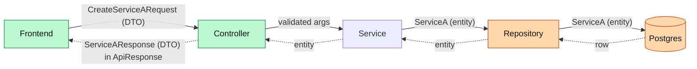

# Repo backend layers

Source of truth for the rules: `docs/CODING_STYLE_BACKEND.md` (Project Structure, Controllers, Input Validation, DTO Mapping) and `docs/SERVICE_ARCHITECTURE.md` (ServiceC authorization). This file explains them for someone learning the backend.

## The onion

```
Client (React, RTK Query generated from Swagger)
  │  JSON = DTO
  ▼
Controller          *.API/Controllers        1. route, validate, authorize
  │  request DTO / plain args
  ▼
Service             *.API/Services           2. business logic, orchestration
  │  entities / domain types
  ▼
Domain              *.Domain                 policies, shared readers, entities
  ├─ Repository     *.Domain/Repository      3. data access
  ▼
Database            Postgres (EF Core)       4. store / retrieve
```

Rule: each layer calls downward, never upward. A controller normally calls a service. It may call a repository directly when a service would only pass the call through (team agreement 2025-10-08: "no law that you have to add an abstraction layer that makes no point"). Add the service as soon as there is a rule, orchestration or an event to publish. A domain object never leaves the controller; map it to a DTO. Note: `docs/CODING_STYLE_BACKEND.md` still says "Do not skip layers" and lags this agreement.

Side doors that skip the controller: Rebus handlers (`*.API/Handlers`, `Messaging`) and workers (`*.Worker.*`). They call services/domain directly. Anything that must hold for **every** path belongs at Domain level or below, not in the controller.

## What goes where

### Controller — the door
- Inherits `RepoController`; `[ApiController]`, `[Authorize]`, `[AcceptTokens]`.
- Validates **shape**: required fields, `StartDate <= EndDate`, GUID not empty → `ApiResponse.ValidationError("…")`.
- Asks ServiceC: `authorizationAdapter.CanDoActionOnCompany(token, action, companyId)` → `Forbidden` if false.
- Calls one service method and returns its `ApiResponse<T>`. In Repo the service builds the envelope (`CODING_STYLE_BACKEND.md:521`, ~200 services); the textbook would put a result type in the service and the HTTP mapping in the controller (see `dotnet-architecture-reference/repo-vs-textbook.md`).
- **Wrong here:** business rules (`if (company.HasContract…)`), EF queries, loops that compute things, mapping repeated in several actions.
- **Symptom:** the controller is long and its tests need a database.

### Service — the brain (for this API)
- The business rule: "an service-a cannot start before employment", "notify the manager when…".
- Orchestrates: repository calls, other services over HTTP, publishing Rebus events.
- **Wrong here:** `HttpContext` and request plumbing; raw SQL; a rule that a worker also needs (then it is duplicated or skipped). Returning `ApiResponse<T>` is the Repo convention, not a smell.
- **Symptom:** the same `if` exists in the service and in a worker.

### Domain — shared truth
- `Models/` = entities (the database shape), `Repository/`, `Policies/` (pure rules, e.g. `ServiceAOccasionPolicy`), shared readers (e.g. `ICallbackEntitlementReader`, used by both API and callback engine so "entitled" has one definition).
- **Wrong here:** DTOs, `ApiResponse`, anything HTTP.
- **Symptom:** `*.Domain` references `*.API`.

### Repository — the hands
- Queries, `Where`, `Include`, projections, pagination. Returns entities or projections.
- May filter by scope that the caller *passes in* (customerId, companyIds).
- **Wrong here:** deciding *whether* the caller may see something (authorization) or *what it means* (business rule).
- **Symptom:** repository method names like `GetServiceAsIfManagerAndNotRetailerB`.

### Database — the floor
- Constraints that must never be broken whatever code runs: unique, FK, not null.
- Migrations are generated, never handwritten.

## Why DTOs

The article version: *"Since data moves across multiple layers, we need Entities (for database representation) and DTOs (for API responses)."* The Repo version of why:

| Without a DTO (entity straight out) | With a DTO |
|---|---|
| A migration that renames a column renames a JSON field → frontend breaks silently | Entity can change; DTO stays; mapping absorbs it |
| Every column leaks, including sensitive personal data and internal flags | Only the fields we chose leave the service |
| Navigation properties → cycles, huge payloads, N+1 lazy loads | Flat, shaped for the screen |
| Frontend types (`generate-api`) follow the DB schema | Frontend types follow a contract we designed |
| **Request side:** client can post fields it should never set (`CustomerId`, `CreatedBy`) — over-posting | Request DTO has only what the client may set |

Cost: a mapping per DTO (`MapFromDomain`, one place, no AutoMapper) and one more type. Worth it at the API boundary. Not needed *inside* a service between two private methods.

Picture:



Green = speaks DTO, orange = speaks entity. The service is where they meet; the mapping happens at the controller boundary.

## Altitude examples from the repo

- **Entitlement in Domain:** `ServiceA.Domain/Services/ICallbackEntitlementReader.cs` — one definition of "entitled to callbacks" shared by API and worker. Higher than a controller check, so the worker is covered.
- **Frontend-only gate (deliberate):** `ServiceD.API/Controllers/SupportController.cs` — non-RetailerB retailers are gated by a PostHog flag in the frontend; the endpoint only needs a signed-in user. Fewer backend branches, accepted trade-off: the endpoint is reachable.
- **Permission map for menus:** `ServiceC.API/Models/DTOs/Authorization/AuthorizedFeatureMap.cs` (`SettingsMap`) — ServiceC tells the frontend what to show, so pages don't each re-derive it.
- **Cross-service authorization:** `docs/SERVICE_ARCHITECTURE.md` — resource services ask ServiceC over HTTP, never read ServiceC's database.
